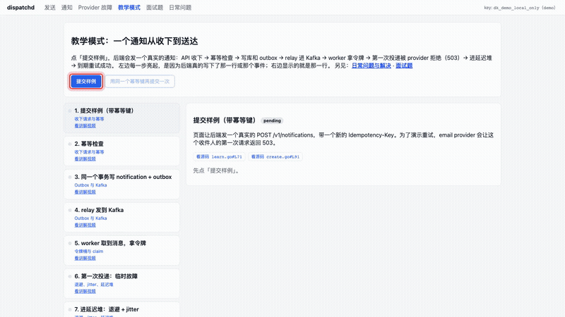
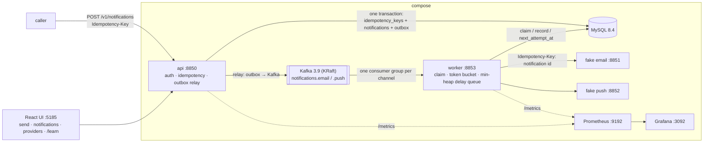

# dispatchd

**A Go notification service that accepts email/push requests over HTTP, keeps delivery state in MySQL, and delivers asynchronously through Kafka, with idempotency keys, exponential backoff with full jitter, a per-provider token bucket and a min-heap delay queue, each proven by a test that fails when that protection is switched off.**

[](../../releases/tag/learn-video)

Full walkthrough video: [Releases → learn-video](../../releases/tag/learn-video). Per-stage clips live in [`docs/videos/`](docs/videos/) and play inside the app at `/learn`.

中文教程（七章，每章一个 git tag）：[`docs/tutorial/`](docs/tutorial/README.md) · 日常问题与解决（10 个，每个一段逐行讲解视频）：[`docs/problems.md`](docs/problems.md) · 面试题（29 题）：[`docs/interview.md`](docs/interview.md) · 值班手册：[`docs/runbook.md`](docs/runbook.md)

## Results (measured in this repo)

All numbers come from this repository's tests and scripts, run on one laptop (Apple Silicon, Docker via colima with 4 CPUs / 6 GiB shared with another project). They move between runs; the raw outputs are committed in [`docs/results/`](docs/results/).

### The three protections, each switched off

`scripts/contrasts.sh` runs each test twice: protection on (must pass) and off via `DISPATCHD_SABOTAGE` (must fail). CI runs the same script.

<!-- contrasts:begin -->
| protection | test | on | off |
|---|---|---|---|
| idempotency keys | `TestRetryAfterTimeoutSendsOnce`: the caller times out at 100 ms, the answer comes at 300 ms, the caller retries with the same key | 1 notification, 1 delivery | 2 notifications, 2 deliveries |
| full jitter | `TestRetriesAfterAnOutageDoNotArriveAsOneSpike`: 200 queued notifications fail together; 1.5 s later the provider recovers but takes only 100 req/s | 18 requests rejected (429) after recovery | 210 rejected |
| token bucket | `TestTokenBucketKeepsUnderTheProviderQuota`: 100 queued emails, provider quota 20/s, our bucket 18/s | 0 × 429 | 424 × 429 |
<!-- contrasts:end -->

### Other measured behaviour

- **Worker killed mid-batch** (`TestWorkerKilledMidBatchLosesNothingAndSendsNothingTwice`, SIGKILL after 75 of 300 provider requests): all 300 delivered, none twice. One run: 75 Kafka redeliveries skipped by the claim, 2 attempts recovered after their lease expired, 2 of those had already reached the provider and were collapsed by the provider-side idempotency key. Without a provider that honours that key, those 2 would have been duplicates (see "What this is not").
- **Channel isolation** (`TestEmailBacklogDoesNotDelayPush`): email throttled to 5/s with a backlog of 40; 20 push notifications all delivered 200 ms after the worker started (1.95 s before the fix in [q07](docs/problems.md#q07)).
- **Load** (`go run ./cmd/loadgen`, open-model, half email / half push, on the full compose stack):

<!-- load:begin -->
| offered | API POST p50 / p99 | email accepted→delivered p50 / p99 | push accepted→delivered p50 / p99 | delivered |
|---|---|---|---|---|
| 60/s for 20 s | 5.0 / 12.3 ms | 7.4 / 23.0 ms | 7.3 / 18.4 ms | 1200 / 1200 |
| 120/s for 20 s | 5.0 / 25.6 ms | 4527 / 10918 ms | 9.5 / 44.6 ms | 2400 / 2400 |
<!-- load:end -->

  At 120/s email arrives at 60/s but its bucket lets 40/s out, so email queues (by design: the bucket protects the provider's quota) while push stays in milliseconds. Raw output: `docs/results/loadtest-*.json`.

## Architecture



- **API** requires `Idempotency-Key`. In one transaction it inserts the key (primary key `(client_id, idem_key)`), the notification and an outbox row; a duplicate key returns the first response byte for byte (`Idempotent-Replayed: true`), a different body with the same key returns 422. The relay in the same process publishes outbox rows (`FOR UPDATE SKIP LOCKED`, acks=all) and records partition/offset.
- **Worker** runs one Kafka consumer per channel. For each message: wait for a token from that provider's bucket, then **claim** the attempt in MySQL (`QUEUED|RETRY_SCHEDULED → SENDING`, only if `attempts` is still what it read), send, record, and only then commit the offset. A temporary failure writes `next_attempt_at` and pushes the retry into an in-memory min-heap whose single timer is always set to the earliest due time. A permanent failure ends in `FAILED_PERMANENT` with the provider code, raw answer and a suggested action.
- **Fake providers** are one Go binary with switchable faults (`ok`, `fail_5xx`, `fail_429`, `permanent`, `slow`, a ratio, a provider-side quota, fail-the-first-N per recipient) that record every request, so tests count duplicates and see the shape of a retry storm.

State machine: `QUEUED → SENDING → DELIVERED | RETRY_SCHEDULED → SENDING … | FAILED_PERMANENT | FAILED_EXHAUSTED`. Every transition is a row in `notification_events`.

## Quick start

Needs Docker with Compose, Go 1.27 and Node 24.

```bash
./scripts/demo.sh            # stack + UI on http://localhost:5185, sends one notification end to end
./scripts/demo.sh stop
```

The demo API key `dk_demo_local_only` is a public placeholder seeded on start; set `DISPATCHD_API_KEYS=id:key:role` to replace it.

```bash
curl -XPOST localhost:8850/v1/notifications -H 'Authorization: Bearer dk_demo_local_only' \
  -H 'Idempotency-Key: signup-ada-1' \
  -d '{"channel":"email","recipient":"ada@example.com","template":"welcome","params":{"name":"Ada"}}'
curl localhost:8850/v1/notifications/<id> -H 'Authorization: Bearer dk_demo_local_only'   # status, attempts, events
```

```bash
./scripts/test.sh            # go test -race against the compose MySQL + Kafka
./scripts/contrasts.sh       # the three protections, on and off → docs/results/
./scripts/e2e.sh             # Playwright through the UI
go run ./cmd/loadgen -rate 60 -duration 20s
node scripts/check_anchors.mjs
```

Ports: API 8850 · fake email 8851 · fake push 8852 · worker metrics 8853 (8854 for a second replica) · UI 5185 · MySQL 33518 · Kafka 19193 · Prometheus 9192 · Grafana 3092. Compose project `dispatchd`.

## Why these choices

- **Idempotency by unique constraint, not check-then-insert.** Retries race the original request; only the database can decide who was first. The key row is the first statement of the create transaction.
- **Transactional outbox.** MySQL and Kafka cannot share a transaction; the outbox row commits with the notification, the relay is at-least-once, and the worker dedups.
- **Claim on (notification id, attempt) in MySQL.** Kafka redelivery after a crash, two workers holding the same message and a restarted worker all reduce to one conditional update that only one caller wins. Kafka transactions would not cover the side effect (an HTTP call to a provider).
- **Leases for in-flight attempts.** A worker that dies mid-send leaves `SENDING` rows; after `lease_until` they are marked `UNKNOWN` and retried with the same provider idempotency key.
- **Full jitter** (wait uniformly in `[0, min(cap, base·2^(n-1))]`). Lowest peak at the provider among the common variants; the cost, some early retries, is harmless for notifications. Decorrelated jitter needs per-notification state and showed no benefit here.
- **Min-heap + one timer instead of polling the table.** Wakes exactly when the earliest retry is due; due times are written to MySQL first and reloaded on start and on every partition assignment.
- **Token bucket taken before the claim**, so a long wait for a token cannot eat the lease. One bucket per provider per worker.
- **One topic and one consumer group per channel**, so a throttled or failing provider only backs up its own channel ([q07](docs/problems.md#q07) is the bug that taught this).
- **franz-go** for Kafka (manual commits, `BlockRebalanceOnPoll` so offsets are never committed for partitions that moved), **go-sql-driver/mysql**, **Prometheus client**. Versions are pinned in `go.mod`, images by tag in `docker-compose.yml` (MySQL 8.4 with `performance_schema` off and a 64 MB buffer pool; Kafka with a 384 MB heap).

## Tests

`go test -race ./...` (via `scripts/test.sh`) runs against real MySQL and Kafka from the compose file: each test gets its own throwaway database and its own pair of topics. If MySQL or Kafka is unreachable the tests **fail** instead of skipping (set `DISPATCHD_SKIP_INTEGRATION=1` to skip on purpose).

- duplicates: same key → same notification; same key with another body → 422; 20 concurrent requests with one key → one row; a caller timeout followed by a retry → one delivery; the replay body is byte-identical;
- provider outages: all 503 then recovery → everything delivered after retries; 503 forever → `FAILED_EXHAUSTED` after `MaxAttempts`;
- rate limits: the token bucket keeps a 100-message backlog under a 20/s provider quota;
- worker restarts: a worker subprocess is SIGKILLed mid-batch; the next one loses nothing and sends nothing twice; retries waiting in a stopped worker's heap are reloaded from MySQL;
- permanent failures carry status, code and an action; the classifier maps 2xx/5xx/408/timeouts/429/4xx;
- delay queue: shuffled inserts come out in order, an earlier item wakes the queue early, an empty or waiting queue does not wake at all;
- token bucket (fake clock): burst then evenly spaced waits, refill capped at burst, concurrent callers never exceed the rate, cancelled waits refund the token;
- metrics the runbook and alerts read are exported; the learn API walks all ten stages.

Two runs of each "can it fail?" control, as printed by the tests (`docs/results/contrast-*.txt`):

<!-- contrast-output:begin -->
```text
(filled from docs/results by the last contrasts run)
```
<!-- contrast-output:end -->

Playwright (`e2e/dispatchd.spec.ts`) clicks through the UI: same-key replay, a permanent failure with its action, provider fault switching, the ten learn stages lighting in order with their real rows and source links that resolve to existing lines, the video slots, and the interview and problems tabs.

## Teaching mode

`/learn` submits one real notification (the email provider is told to fail the first attempt for that recipient only) and polls `GET /v1/learn/runs/{id}`, which derives each stage from MySQL rows and events and the provider's request log; nothing is animated. Each stage shows its row (the idempotency key, the outbox row, the Kafka partition and offset, the token bucket balance, the backoff calculation, the heap wake-up delay, the transitions) and links to the exact lines at the commit the UI was built from (generated from `@learn` markers by `scripts/learn_anchors.mjs`, checked by `scripts/check_anchors.mjs`). `video/record.mjs` records the page with red frames on each value the narration talks about.

Observability: Grafana dashboard `deploy/grafana/dashboards/dispatchd.json` (auto-loaded), alert rules in `deploy/prometheus/alerts.yml`, each pointing at a section of [`docs/runbook.md`](docs/runbook.md).

## What this is not

- **Not exactly-once to the outside world.** Between "the provider answered 200" and "we wrote DELIVERED" there is a window; a crash there resends the notification. The fake provider collapses the resend by `Idempotency-Key`; a real provider without idempotency support would deliver it twice (2 of 300 in the kill test above).
- **The token bucket is per worker**, not global: N workers send at N × the configured rate. A shared bucket (e.g. Redis) would be needed for a hard global quota.
- **Retries that live only in a worker's heap** are picked up by other workers when partitions are reassigned or on restart, not continuously; a worker that stays alive but hangs would hold them until its lease logic or a restart releases them.
- **MySQL is the bottleneck by design here**: each delivery writes several rows (state, attempt, events). The demo database has a 64 MB buffer pool; the numbers above are from that.
- **Fake providers only.** No SES/SendGrid/FCM/APNs adapters, no bounce/complaint webhooks, no unsubscribe list, no per-tenant fairness.
- **`DISPATCHD_SABOTAGE` exists for tests and demos.** It defaults to off; never set it anywhere real.
- **Demo credentials** (`dk_demo_local_only`, MySQL `dispatchd/dispatchd`) are public placeholders for the local stack.

## License

MIT
